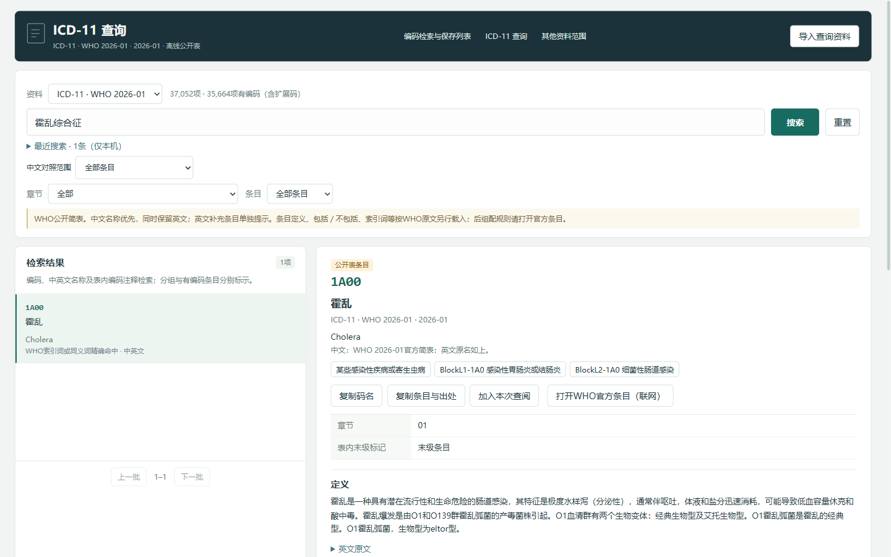

# 病案编码快捷检索

**作者：深大阿宗｜免费提供，请勿购买**

这是一款面向病案编码、病案管理和编码学习的 Windows 离线辅助查阅工具。我希望把日常查询时需要反复翻找的目录、主导词路径、分类正文和参考资料放到一起，让使用者既能较快找到候选，也能看到它来自哪套资料、属于哪个版本。

当前版本：**0.9.1**。本版随包提供主导词、分类正文、ICD-O-4 和 ICD-10／ICD-11 映射，无须先导入资料即可使用。

## 重建背后的工作

主导词和分类正文看起来是可搜索的文字，真正难的地方是把原书里的**层级、位置和编码关系**准确地整理出来。我不想只得到一份能搜到词的表，还希望出现疑问时，能知道资料来自哪一版、原书大致在哪一页，以及整理时遇到过什么问题。

这部分资料按自有的 ICD-10 中文第二版第一卷、第三卷和 ICD-9-CM-3 2011 中文版重建。原书是扫描页，文字层不能直接使用，需要先逐页识别，再结合版面、编码顺序、英文栏及官方资料做核对。我的工作是确定资料范围和处理方向，结合程序规则和 AI 辅助反复识别、比对与核对原图。

### 文字读出来，还要判断它属于哪一层

索引中的破折号决定主导词和修饰词的上下级。识别程序有时不读破折号，有时把几个读成一个；如果层级判断错了，一行看似没错的文字也可能被挂到另一个主导词下面，整条路径就变了。为此需要结合页面上的破折号长度、中英文识别结果和上下文反复调整规则，再回到原图抽查。

水印、折行、续前页和页脚也会干扰识别：有的行被整行漏掉，有的页码被当作标题，还有的说明文字被误当成新的条目。最隐蔽的是识别结果看起来完整，实际拿下一行顶替了标题，或者一个编码被读错，导致程序跳过一整段。每次修正规则后，都需要重新运行和比较，检查是否引入新的遗漏。

### 表格要按单元格重建，字形错误还要回图核对

肿瘤表的一行有多个性质不同的编码，整页识别容易把中英文和不同列的编码混在一起。重建时需要按版面切分单元格，分别识别，再结合各栏编码范围检查；原书中的特殊符号也要单独寻找，避免只留下一个码而漏掉其他栏。

另一个困难是“安静的错误”：例如“植入”被读成“植人”，“肾盂”被读成“肾孟”。这些字本身都存在，程序不一定会报错，却可能让使用者搜索时漏掉结果。为发现这类问题，工作中使用了中英文和目录术语比对、形近字筛查，再对可疑项逐条对照原图；对原书本身的异体字或印刷特点则保留来源，不随意统一成另一种写法。

### 文字看似没错，关系仍可能错

这轮复审又发现，框里的注释不能简单挂到紧挨着它的上一行。供者来源说明属于整个移植主导词，椎骨数量说明属于脊柱再融合术；挂错位置，会把通用说明变成某个具体操作的限定。另有18处相邻的粗体主导词被识别成一行，按原图拆开后净增21条记录。例如“贲门松弛”和“本森病”在书中是两个独立主导词，不能因为文字靠在一起就当成一条路径。

编码还要区分“本行赋码”“方括号另编码”和“注释提及”。第949页两条手术索引各有第二个附加码 `[45.91]`，需要同时保留；`00.43` 出现在注释中，应能检索到这段说明，却不能被赋成该注释条目的编码。原书两栏如果本身不同，也要把差异记下来，不能悄悄统一成推测值。

### 改完一行，还要检查它影响了哪些结果

当前三组索引合计75,361条路径，两套分类正文合计15,423个节点。这是结构化记录数，不等于同样数量的独立疾病，也不代表每一条都经过人工逐字校对。本轮先复核136条已有整理决定，覆盖56行编码变化及23条删除，再通过多种特征筛查和原图核对补充68条决定，其中67条修正、1条保留原印并说明差异。

每次修正都先记下位置和依据，再从生成脚本重建并比较新旧数据，检查名称、编码和下级路径是否只按预期变化。检索也要单独验证：普通关键词先列主导词，编码查询能到各级路径；追加关键词时仍保留编码限定，返回查阅时恢复之前的范围。数据关系与查询行为都要正确，资料才方便日常使用。

页面和发行包还有另一层工作：长名称要能完整读到，编码与符号要复制完整，本机运行正常的代码还要在独立解压的 Windows 程序中再检查。GitHub 只发布整理后的说明、截图和运行附件；工程源码、原书、逐页识别文件与个人查阅记录不随包。资料校对、查询设计、显示适配和发行检查是分别验证的，不能用其中一项通过代替其他项目。

**目前程序标出的可疑行已逐条对照原图处理，未标出的行只做过抽查，并不代表全书逐字无误。**这些整理需要编码知识、资料辨别、程序处理和反复核对共同配合。工具保留资料版本和来源，是为了让使用者在遇到疑点时能继续核实；原书 PDF 和逐页 OCR 不随下载包提供。

## 下载与运行

1. 打开 [最新版下载](https://github.com/MRxu-1/medical-record-search/releases/latest)，下载 `medical-record-search-v0.9.1-win-x64.zip`，不要下载 GitHub 自动生成的 Source code 包。
2. 完整解压后运行 `病案编码快捷检索.exe`，保留旁边的组件和“程序资源”文件夹。
3. 需要 Windows 10/11 64 位、.NET Framework 4.6.2 或以上和 [WebView2 Runtime](https://developer.microsoft.com/microsoft-edge/webview2/)。查询与个人保存可离线使用，主动打开官方参考网站时需要网络。

更新前建议导出 JSON 备份，再完整替换解压目录。软件没有自动更新；公开版个人保存位于当前 Windows 用户的独立目录。

## 功能介绍

### 诊断、手术和灰码查询

- **诊断编码**：按编码或名称查询诊断目录，查看原始码名、资料来源及编码角色。成对编码、剑号／星号、组合码和仅附加编码按已有记录展示，复制时保留原文。
- **手术与操作**：查询手术名称、编码和拼音首字母；可按已有类别、级别筛选，并查看目录提供的手术级别、操作类别和微创目录收录等属性。
- **灰码及差异**：查看灰码表收录标记、同码异名和换码等已有记录。医保诊断侧只覆盖灰码表关联范围，不能当作完整医保目录；灰码标记本身不自动决定禁用或报销结论。
- **多种查找方式**：支持编码、中文、空格分隔的关键词及拼音首字母。连续中文全词无结果时可按字序补充候选，常见称呼辅助会标明命中原因，也可以关闭。

### 主导词路径与分类正文

普通查询优先列出主导词，按整词、开头、包含及括号内命中排序；下级词条可展开查看，无主导词命中时直接显示匹配路径。可按书内编码反查所有层级，叠加关键词缩小范围，并从相关路径查看分类正文。疾病索引、损伤外因索引和手术索引分别标明所用资料；分类正文保留已有的包括、不包括、注释及来源信息，便于继续核对。

路径和中文正文依据自有原书重建，不能视为所在机构现行目录或完整人工校对结果。需要进一步核对时，请使用自己持有的相应版本原书；包内不包含原书 PDF 和逐页 OCR。

### ICD-10、ICD-11 和 ICD-O-4

- **WHO ICD-10 多版本**：查询 2008、2010、2016、2019 四版，中文在前，可检索中文并展开英文对照；逐条注明来源。与国临目录分开标示，不自动改动国内扩展码。
- **WHO ICD-11**：查询 2026-01 中英文简表和条目详情，查看定义、包括、不包括、索引词、同义词、相关下位条目及官方 URI；部分条目可展开英文原文。
- **ICD-10／ICD-11 对照**：查看 WHO 2026-01 映射及反向关联，映射资料的 ICD-10 侧为 2019 版。结果供版本对照和继续查阅，不能直接视为临床等价或自动替换编码。
- **ICD-O-4**：查询 IARC 形态学、部位、可选细分及变更表。中文参考单独标明来源，并非 IARC 官方译名，也不自动把旧 M 码转换为 ICD-O-4。

本工具译名标为非官方，未经专家审核，仅供辅助查阅；请结合英文原文和适用资料核对。ICD-11 传统医学第二部分中缺少官方中文的条目保留原文。

### 速查、图解与个人整理

- **速查附表**：抗肿瘤药物按医保药品目录分类提供编码候选；神经刺激器结合 FDA 器械型号和规则；骨修复与填充材料按材料类型提供规则。候选需结合病历及适用要求核对。
- **手术图解**：提供开放来源的手术相关图解，按主题辅助理解；图解与编码不是一一对应关系，来源和许可随图标注。
- **保存、比较和复制**：将条目加入“本次”或“常用”，记录备注，固定一条参照继续比较；可复制码名或带来源的依据，并通过 JSON 导出、导入备份。
- **最近搜索与可选资料**：最近搜索保存在本机。软件支持导入本工具格式的结构化资料包，导入的同类型资料会覆盖对应的随包资料；不能直接导入任意 PDF 或 Excel，收藏不因此覆盖。

## 资料范围与使用边界

| 资料 | 本版范围 |
|---|---|
| 诊断、手术及灰码 | 随包目录和灰码表按各自来源、版本显示；医保诊断侧非完整目录 |
| 主导词与分类正文 | ICD-10 第二版及 ICD-9-CM-3 2011 原书重建的结构化资料；未全书逐条校对 |
| WHO ICD-10／ICD-11 | ICD-10 2008 基础版及多版本差异；ICD-11 2026-01 中英文简表与详情；WHO 映射供对照 |
| ICD-O-4 | IARC 英文公开表及另行标源的中文参考；中文参考不是 IARC 官方译名 |
| 速查和图解 | 医保药品目录、FDA 器械资料、材料规则和开放来源图解；来源及适用范围分别标注 |
| 本包未附 | 原书 PDF、逐页 OCR、个人保存、研究原件和独立源码工程 |

本工具用于辅助查阅，不能代替对病历、机构现行目录和编码规则的判断，也不自动决定编码或报销。第三方资料的使用条件分别适用；WHO 映射单独书面授权以及原书、ICD-O-4 公开再分发条件尚未确认，详见[第三方资料说明](第三方资料说明.md)。

下载包未进行代码签名，可使用发行页的 SHA-256 校验下载完整性。

## 界面与反馈

如遇检索或显示问题，可在 [Issues](https://github.com/MRxu-1/medical-record-search/issues) 提供软件版本、系统版本、查询内容、预期与实际结果。请先清除截图中的个人备注、患者信息和院内地址，不要上传完整病历或个人备份。
